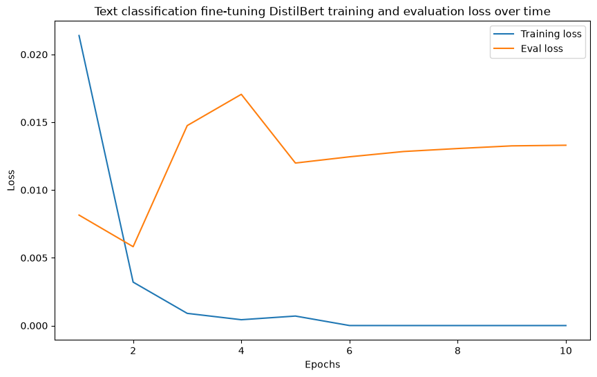

# 🍗🚫🍔 Food / Not Food Text Classifier


A small text classifier that decides whether a sentence or image caption is about **food** or **not food**. It is a [DistilBERT](https://huggingface.co/distilbert/distilbert-base-uncased) model fine-tuned on 20,000 synthetic captions, packaged as a Hugging Face model, a dataset, and this web demo Space.

- **Model:** [vjabarca/HuggingFace_food_not_food_text_classifier-distilbert-base-uncased](https://huggingface.co/vjabarca/HuggingFace_food_not_food_text_classifier-distilbert-base-uncased)
- **Dataset:** [vjabarca/learn_hf_food_not_food_image_captions](https://huggingface.co/datasets/vjabarca/learn_hf_food_not_food_image_captions)
- **Demo (this Space):** [HuggingFace_food_not_food_text_classifier-distilbert-base-uncased_web_demo](https://huggingface.co/spaces/vjabarca/HuggingFace_food_not_food_text_classifier-distilbert-base-uncased_web_demo)

## Table of Contents

- [Overview](#overview)
- [How It Works](#how-it-works)
- [Dataset](#dataset)
- [Model and Training](#model-and-training)
- [Results](#results)
- [Tech Stack](#tech-stack)
- [Installation](#installation)
- [Usage](#usage)
- [Configuration](#configuration)
- [Project Structure](#project-structure)
- [Known Issues & Limitations](#known-issues--limitations)
- [Roadmap](#roadmap)
- [Contributing](#contributing)
- [License](#license)
- [Author & Support](#author--support)
- [Acknowledgments](#acknowledgments)

## Overview

Knowing whether a caption is about food is a useful filter, for example when sorting image captions, cleaning a dataset, or routing content. This project walks through the whole workflow on a small, fast model:

1. Build a labeled dataset of food and not-food captions
2. Fine-tune DistilBERT for binary text classification
3. Evaluate on held-out data and on a harder, hand-curated test set
4. Publish the model and dataset to the Hugging Face Hub
5. Wrap the model in a shareable web demo

## How It Works

```text
text  ->  tokenizer (distilbert-base-uncased)  ->  DistilBERT (6 layers)  ->  2 logits
      ->  softmax  ->  {"food": p, "not_food": 1 - p}
```

Labels: `0 = not_food`, `1 = food`. The model returns a label and a confidence score for each input.

## Dataset

[`vjabarca/learn_hf_food_not_food_image_captions`](https://huggingface.co/datasets/vjabarca/learn_hf_food_not_food_image_captions):

| | |
|---|---|
| Captions | 20,000 |
| Classes | `food` (10,000) and `not_food` (10,000), perfectly balanced |
| Columns | `text`, `label` |
| Source | Synthetic, generated with an LLM chat assistant (Mistral Chat) over several iterations to grow a list of unique captions |

Synthetic data made it fast to prototype and scale up. The captions include food items, food scenes, and not-food scenes such as landscapes, streets, and animals. It also contains some deliberately tricky not-food sentences that use food words figuratively.

Split used for training: 80% train (16,000) and 20% test (4,000), with `seed=42`.

## Model and Training

| Setting | Value |
|---|---|
| Base model | `distilbert/distilbert-base-uncased` |
| Parameters | 66,955,010 (all trainable) |
| Learning rate | 1e-4 |
| Batch size | 32 |
| Epochs | 10 (5,000 steps) |
| Evaluation / checkpoints | every epoch, keep the best by evaluation loss |
| Seed | 42 |
| Hardware | Apple MacBook GPU (PyTorch MPS), about 12 minutes of training |



Evaluation loss is lowest at epoch 2 while training loss keeps falling, so the model overfits quickly. The saved model is the best checkpoint (epoch 2).

## Results

**Held-out split of the synthetic dataset (4,000 captions):**

| Metric | Value |
|---|---|
| Accuracy | 99.85% |
| Loss | 0.0058 |

This split also picked the best checkpoint and comes from the same generator as the training data, so it is an optimistic number.

**Harder test set (200 new captions generated with Claude, 100 food and 100 not food).** The captions were requested to be natural, ambiguous, and harder than the training data, with the count kept to 200 to avoid repeats:

| Metric | Value |
|---|---|
| Accuracy | 91.5% (183 of 200) |
| Precision (food) | 0.86 |
| Recall (food) | 0.99 |
| Recall (not food) | 0.84 |

The model almost never misses food (1 error), but it calls about 16% of not-food captions "food". Typical mistakes are not-food captions that mention kitchen or dining objects, for example a pair of chopsticks resting on a ceramic holder. Accuracy drops from 99.85% to 91.5% on this set, which shows how much easier the synthetic test split is.

**Inference speed on a MacBook GPU (MPS):** about 4.9 ms per sentence one at a time, and about 0.9 ms per sentence in batches of 32.

**Sample predictions:**

| Text | Prediction | Confidence |
|---|---|---|
| A plate of croissants | food | 99.99% |
| I whipped up a fresh batch of code, but it seems to have a syntax error | not_food | 99.98% |
| Her social media post was the perfect recipe for a viral sensation | not_food | 99.99% |
| A 2007 Subaru Impreza | not_food | 63% |
| His resume is just alphabet soup of certifications with no real experience | food | 99.97% (wrong) |

## Tech Stack

- **Language:** Python 3.13
- **Modeling:** Hugging Face Transformers 5.x (`Trainer`, `pipeline`), Datasets, Evaluate, PyTorch
- **Metrics:** scikit-learn (accuracy, precision, recall, classification report)
- **Local demo:** Gradio
- **Hosting:** Hugging Face Hub (model, dataset) and Spaces (static web demo)

## Installation

To use the model or run the demo locally:

```bash
# 1. Create and activate a virtual environment
python -m venv .venv
source .venv/bin/activate        # Windows: .venv\Scripts\activate

# 2. Install dependencies
pip install transformers torch gradio
```

To reproduce training or evaluation, also install the libraries used in the notebooks:

```bash
pip install datasets evaluate accelerate scikit-learn pandas matplotlib jupyter
```

## Usage

### Use the model from Python

```python
from transformers import pipeline

classifier = pipeline(
    task="text-classification",
    model="vjabarca/HuggingFace_food_not_food_text_classifier-distilbert-base-uncased",
    top_k=1,
)

print(classifier("A plate of croissants"))
# [[{'label': 'food', 'score': 0.9999}]]

print(classifier(["I whipped up a fresh batch of code, but it seems to have a syntax error",
                  "A steaming bowl of ramen with a soft-boiled egg"]))
```

Pass a list for batch predictions. Set `top_k=None` to get the score for both labels.

### Run the Gradio app locally

`app.py` loads the model from the Hub and shows a simple text box with the label and confidence:

```bash
python app.py
```

Then open the local URL that Gradio prints (by default `http://127.0.0.1:7860`).

### Web demo

Open the [Space](https://huggingface.co/spaces/vjabarca/HuggingFace_food_not_food_text_classifier-distilbert-base-uncased_web_demo), type a sentence or caption, and click **Analyze Description**. See [Known Issues](#known-issues--limitations) for the current state of the web demo.

### Reproduce training and evaluation

1. Run `HuggingFace_Food_Caption_Classification.ipynb`: loads the dataset, tokenizes, fine-tunes, evaluates, saves the model, and builds the demo files.
2. Run `Food_Caption_Test.ipynb`: scores the saved model on `200_image_captions.json` (columns `text` and `label`) and prints accuracy, precision, and recall.

## Configuration

- **Hugging Face token:** only needed to push a model, dataset, or Space to the Hub, or to read private repos. Log in with `hf auth login` or set the `HF_TOKEN` environment variable. **Never write a token in a notebook or commit it.**
- **Local paths:** the notebooks use absolute paths on the author's machine (`local_model_path`, the test data path). Change them, or use the Hub model ID instead.
- **Device:** the notebooks pick CUDA, then Apple MPS, then CPU automatically.

## Project Structure

```text
.
├── README.md                                     # this file (keep the YAML block at the top)
├── index.html                                    # static web demo page
├── style.css                                     # Space template stylesheet
├── transformers.min.js                           # bundled Transformers.js library
├── app.py                                        # Gradio app for local use
├── requirements.txt                              # dependencies for app.py
├── notebooks/
│   ├── HuggingFace_Food_Caption_Classification.ipynb   # data, training, evaluation, demo
│   └── Food_Caption_Test.ipynb                         # test on 200 harder captions
├── docs/
│   └── loss_curves.png
└── LICENSE
```

## Known Issues & Limitations

- **Web demo needs repair:** the committed `index.html` sends its request to `https://huggingface.co` with no inference path, so as written it cannot return a prediction. The bundled `transformers.min.js` is not loaded by the page. The Space type is `static`, so `app.py` and `requirements.txt` are ignored there.
- **Synthetic training data:** the captions come from an LLM, so the model learns that style. Real-world text can look different.
- **Optimistic main score:** the 99.85% result uses the same generator as training, and the same split chose the best checkpoint. Treat the 91.5% harder-set result as more realistic.
- **Bias toward "food":** on the harder set, about 16% of not-food captions were labeled food, especially with kitchen or dining objects.
- **Figurative language:** food words used as metaphors are mostly handled, but not always (for example "alphabet soup of certifications").
- **Implied food:** captions that imply cooking without naming food (for example "Prepped all morning for this glaze") may be labeled not food.
- **Overconfidence:** many wrong predictions still have scores above 99%, so the confidence is not a reliable error signal.
- **Scope:** English only, short captions, two classes.
- **Hub token in notebooks:** remove any hardcoded token from notebooks before sharing them, and revoke it if it was ever committed.
- **Local paths:** the notebooks contain machine-specific paths.

## Roadmap

- [ ] Repair the web demo (switch the Space to Gradio, or serve the model through an ONNX build with Transformers.js)
- [ ] Add real-world and adversarial captions to training and evaluation data
- [ ] Add a validation split separate from the test split, and report the final test score once
- [ ] Add the 200-caption test set to the Hub as a dataset
- [ ] Calibrate confidence scores (for example temperature scaling)
- [ ] Add a third "unclear" class for ambiguous text
- [ ] Add a confusion matrix and a review of the highest-confidence errors
- [ ] Try smaller or multilingual models

## Contributing

Contributions, bug reports, and feature ideas are welcome.

1. **Report a bug or request a feature:** open a thread in the [Community tab](https://huggingface.co/spaces/vjabarca/HuggingFace_food_not_food_text_classifier-distilbert-base-uncased_web_demo/discussions) and include the input text, the expected label, and the prediction you got.
2. **Submit a change:** fork or duplicate the Space, make your changes, and open a pull request from the Community tab.

Examples of wrong predictions are especially useful for improving the dataset.

## License

Distributed under the MIT License. See [`LICENSE`](LICENSE) for details. The base model DistilBERT is released under the Apache 2.0 license.

## Author & Support

**Victor J. Abarca**, San José, CA

- Hugging Face: [@vjabarca](https://huggingface.co/vjabarca)
- GitHub: [@vjabarca](https://github.com/vjabarca)

For questions or problems, please use the Community tab.

## Acknowledgments

- [Hugging Face](https://huggingface.co/) for Transformers, Datasets, the Hub, and Spaces
- [DistilBERT](https://huggingface.co/distilbert/distilbert-base-uncased) by Sanh et al. as the base model
- The Learn Hugging Face material by Daniel Bourke ([learnhuggingface.com](https://www.learnhuggingface.com/)), whose food / not food walkthrough this project follows
- Mistral Chat and Claude for generating the training and test captions
